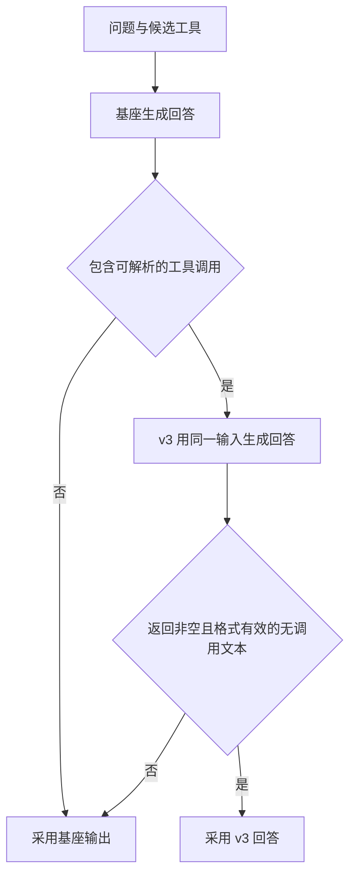

# 两阶段工具调用模型

基于 Qwen2.5-0.5B-Instruct 和 LoRA 的工具调用实验。项目旨在减少候选工具无法完成请求时的误调用，同时保留基座模型正确选择工具和填写参数的能力。

## 评测结果

在 BFCL v4 的 `simple_python` 和 `irrelevance` 子集中，各取索引 200–239 的 40 条留出样本。三个方案使用相同的问题和工具列表。`simple_python` 使用 BFCL 的 Python AST 检查器判断工具名和参数，`irrelevance` 按输出中的 Qwen 工具调用标签判断是否发起调用。

| 指标 | 基座 | LoRA v3 单独运行 | 基座 + v3 拦截 |
| --- | ---: | ---: | ---: |
| 正确调用率（`simple_python`） | 27/40（67.5%） | 23/40（57.5%） | **27/40（67.5%）** |
| 正确不调用率（`irrelevance`） | 21/40（52.5%） | 23/40（57.5%） | **26/40（65.0%）** |
| 无关工具误调用次数 | 19 | 17 | **14** |

两阶段方案使无关工具误调用率从 47.5% 降到 35.0%，下降 **12.5 个百分点**，相对减少 **26.3%**。基座原本答对的 27 道调用题全部保留。

串联推理在 RTX 3060 Laptop GPU 上运行。80 条样本中有 58 条触发第二阶段，同一轮的基座阶段平均耗时 1.69 秒/题，完整流程平均耗时 2.58 秒/题。调用题中的漏调用从 1 道增至 2 道，新增的 `simple_python_233` 在基座阶段已因参数缺失被判错。

## 训练与推理

1. **准备训练数据。** 清洗 xLAM 样本，将工具参数转换为 JSON Schema，并用输入指纹去重。v1 使用 2,000 条调用样本。
2. **构造无调用配对。** v3 保留配对原题的调用正例，并构造只提供不适用工具的无调用样本。最终训练集由 **1,800 条调用样本和 200 条无调用样本**组成。使用 TRL 和 PEFT 微调 LoRA，仅对助手的响应 token 计算训练损失。
3. **按需拦截调用。** 基座负责选择工具和填写参数，系统根据 v3 对同一输入的作答决定是否拦截。两阶段通过开关 LoRA 复用一份模型权重。

## 代码与复现

技术栈包括 Python、PyTorch、Transformers、TRL、PEFT、Pydantic 和 BFCL v4。

| 代码 | 作用 |
| --- | --- |
| [prepare_data.py](tool_calling/prepare_data.py) 与 [split_data.py](tool_calling/split_data.py) | 清洗原始数据，构造训练、验证和测试划分 |
| [prepare_v3.py](tool_calling/prepare_v3.py) | 根据配对清单生成调用和无调用混合训练集 |
| [train_lora.py](tool_calling/train_lora.py) | 训练并保存 LoRA 检查点 |
| [v3_veto.py](tool_calling/v3_veto.py) | 串联基座推理与 v3 判断，并记录耗时 |
| [generate_bfcl.py](tool_calling/generate_bfcl.py) 与 [score_bfcl.py](tool_calling/score_bfcl.py) | 生成 BFCL 预测、评分并输出汇总 |

从安装依赖、获取数据和模型到训练 v3、重跑 80 题评测的命令见[复现指南](docs/reproduce.md)。依赖版本见 [requirements.lock.txt](requirements.lock.txt)。

## 上游来源

- 基座模型为 Qwen 团队发布的 Qwen2.5-0.5B-Instruct，模型卡标注 Apache-2.0。 [模型卡](https://huggingface.co/Qwen/Qwen2.5-0.5B-Instruct)
- 训练数据源为 Salesforce AI Research 的 xLAM Function Calling 60K，数据卡标注 CC BY 4.0。本项目对其样本做了筛选与格式转换，并为选中的原题构造无调用配对。原数据由 Zuxin Liu 等人的 APIGen 工作发布。 [数据卡](https://huggingface.co/datasets/Salesforce/xlam-function-calling-60k) · [APIGen 论文](https://arxiv.org/abs/2406.18518) · [CC BY 4.0](https://creativecommons.org/licenses/by/4.0/)
- 外部评测使用 Berkeley Function Calling Leaderboard（BFCL）v4。复现指南列出了评测代码与题目所用的 Git 提交。 [BFCL 项目](https://github.com/ShishirPatil/gorilla/tree/main/berkeley-function-call-leaderboard)
